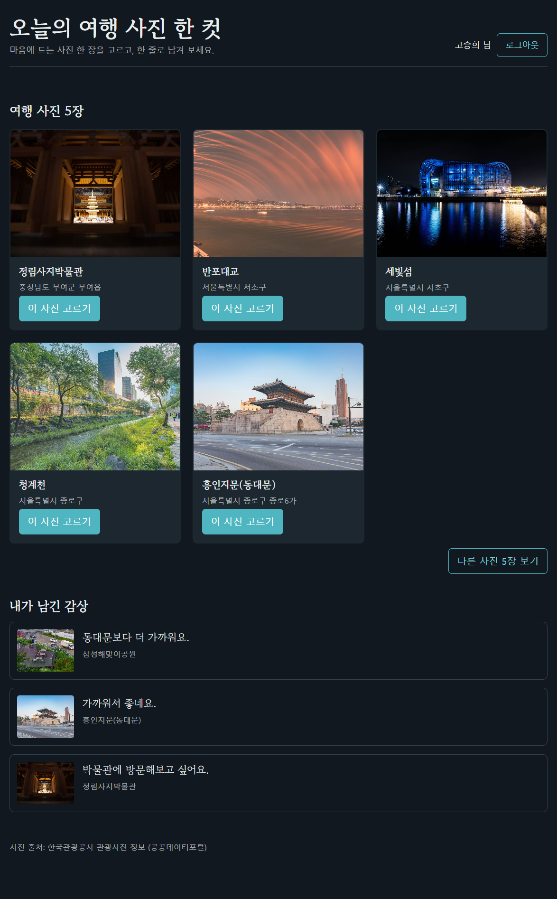

# 오늘의 여행 사진 한 컷

한국관광공사 관광사진 5장 중 마음에 드는 한 장을 골라 한 줄 감상을 남기고, Firebase에 저장해서 다시 볼 수 있는 웹 앱입니다.

## 배포 링크

https://seungheeko5.github.io/travel-photo/

## 사용한 API

- 공공데이터포털(data.go.kr) 「한국관광공사_관광사진 정보_GW」

## 사용 기술

- HTML / CSS / JavaScript
- Firebase Authentication (Google 로그인), Cloud Firestore
- GitHub Pages

## 주요 기능

1. 관광사진 API에서 사진과 제목 5개 불러오기
2. Google 계정으로 로그인 / 로그아웃
3. 사진 1장을 골라 한 줄 감상 작성 후 Firestore에 저장
4. 내가 남긴 감상 목록 조회

## 실행 화면

